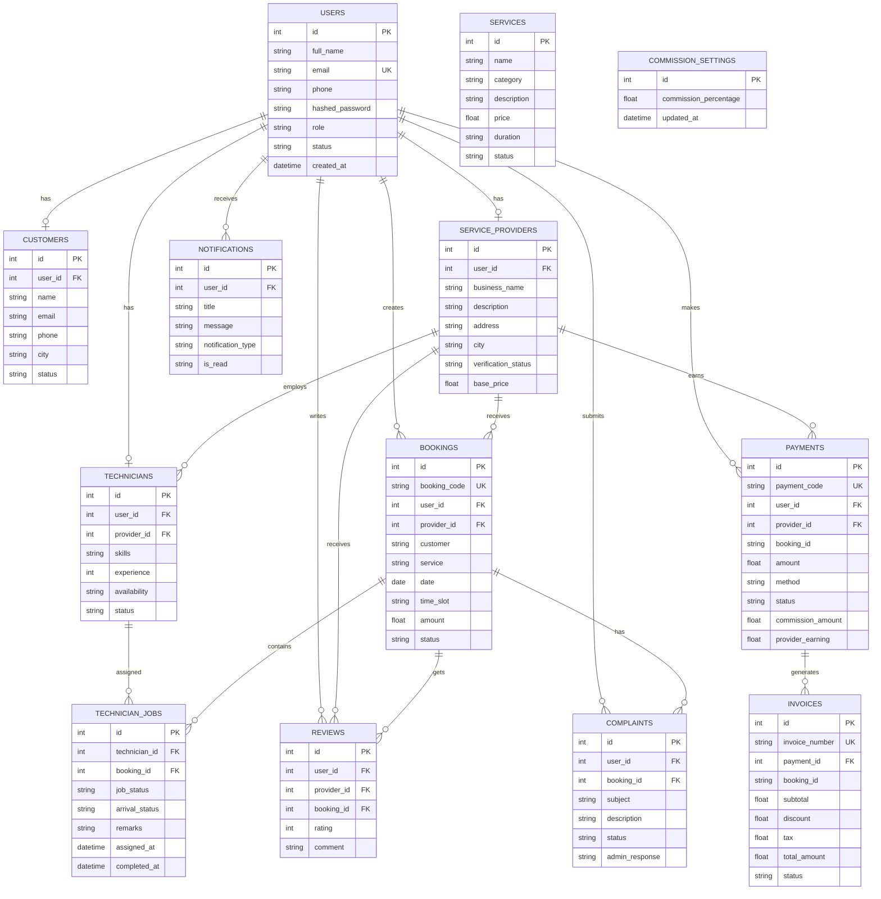

# HomeServe – Entity Relationship Diagram (ERD)

This ERD documents the HomeServe Home Services Booking SaaS database based on the model structure discussed for the project.

## 1. ER Diagram

## 2. Main table relationships

| Parent table | Child table | Relationship |
|---|---|---|
| Users | Customers | One-to-One (intended profile relationship) |
| Users | Service Providers | One-to-One (intended profile relationship) |
| Users | Technicians | One-to-One (intended profile relationship) |
| Users | Bookings | One-to-Many |
| Users | Payments | One-to-Many |
| Users | Notifications | One-to-Many |
| Users | Reviews | One-to-Many |
| Users | Complaints | One-to-Many |
| Service Providers | Bookings | One-to-Many |
| Service Providers | Technicians | One-to-Many |
| Service Providers | Payments | One-to-Many |
| Service Providers | Reviews | One-to-Many |
| Technicians | Technician Jobs | One-to-Many |
| Bookings | Technician Jobs | One-to-Many |
| Bookings | Reviews | One-to-Many |
| Bookings | Complaints | One-to-Many |
| Payments | Invoices | One-to-Many |

## 3. Recommended database improvements

Review these fields against the actual SQLAlchemy models before applying migrations:

1. `bookings.service` is represented as text in this diagram. Consider replacing it with `service_id` as a foreign key to `services.id`.
2. `payments.booking_id` is represented as text. Consider changing it to an integer foreign key referencing `bookings.id`.
3. `invoices.booking_id` is represented as text. Consider changing it to an integer foreign key referencing `bookings.id`.
4. `services.category` is represented as text. If categories need independent management, create a `service_categories` table and reference it with `category_id`.
5. Confirm that each profile table's `user_id` has a unique constraint if each user can have only one profile of that type.

## 4. Important note

This is a documentation draft based on the model/table structure described for the project. Before submitting it as the definitive database ERD, compare every table and field with the current SQLAlchemy model files and the live database schema. The relationship lines above should be treated as confirmed only where matching foreign-key constraints exist in the code.
